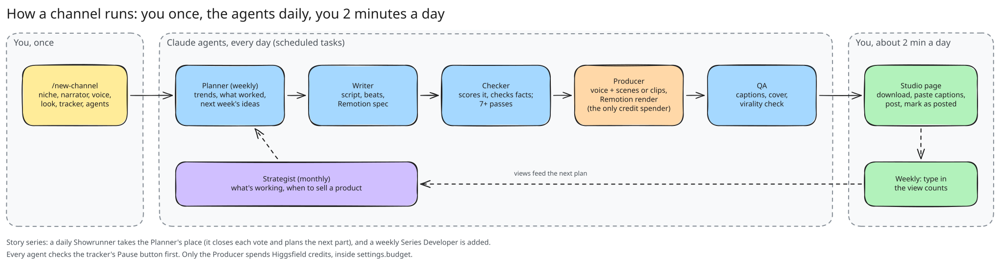
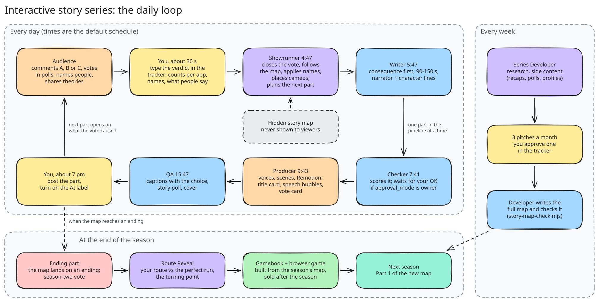

# Faceless Studio

Run faceless short-video channels on TikTok, Instagram Reels and YouTube Shorts with Claude doing
the work: narrated stories, explainers and text-on-screen videos with nobody on camera (or, if you
want one, a fictional AI character). You set a channel up once; six scheduled agents then plan,
write, fact-check, produce and caption a video every day, and you post it from a studio page in
about two minutes.



## What you need

| | why | cost |
|---|---|---|
| [Claude](https://claude.ai) (Pro or Max) with **Claude Code** or the desktop app | runs everything, hosts the scheduled agents and the studio page | subscription |
| [Higgsfield](https://higgsfield.ai) | voices, b-roll, optional AI character clips, the render sandbox | credits (a faceless video is mostly free Remotion scenes; ~60 per AI clip; you set a monthly cap) |
| [ElevenLabs](https://elevenlabs.io) *(optional)* | alternative voices | your plan |
| Node 20+, ffmpeg, git | local setup and test renders | free |

## Setup (5 minutes)

```bash
git clone https://github.com/Zman2087/faceless-studio.git
cd faceless-studio
./setup.sh
```

`setup.sh` checks your tools, installs the Remotion engine, downloads the Remotion skills
([remotion-dev/skills](https://github.com/remotion-dev/skills)),
packages every skill as a zip for the Claude app, renders two test videos, and then **starts Claude
with `/new-channel`**, which asks about your first channel.

Connect Higgsfield when Claude asks:
- **Claude Code:** type `/mcp` and authenticate `higgsfield` (and `elevenlabs` if you want it) — they're already in `.mcp.json`.
- **Claude app:** Settings → Connectors → Add custom connector → `https://mcp.higgsfield.ai/mcp`.

> Using only the Claude app (no terminal)? Upload the zips in `dist/skills/` under Settings →
> Capabilities → Skills, attach this repo, and say "run /new-channel".

## What `/new-channel` does

1. Asks 7 questions in one go: niche, faceless or on camera, the channel's name and narrator, how it sounds, its look, whether scripts wait for your OK, budget.
2. Researches the niche (top creators, hooks working now) and picks three content pillars.
3. Sets the **look** (brand colours, scene style, b-roll) and lets you pick a **narrator voice** from samples. On-camera channels also get a **face anchor**, a **3-panel character sheet** and a **location** (Higgsfield Soul). *(Tells you the credit cost first.)*
4. Publishes your **studio page** (a private Claude Artifact) and seeds it with the channel.
5. Fills the six agent prompts and creates the **scheduled tasks**.
6. Pitches 8 ranked first-video ideas and queues your picks.

The first finished video lands after the next producer run (or say **"make the first video now"**).

## Interactive story series
Pick "interactive story" as the format and you get a choose-what-happens series instead of a host.
Each part (90-150 s, an engaging narrator plus short in-character lines in speech bubbles) opens on
what the audience's last vote caused and ends on an A/B/C choice. Viewers vote in the comments and in
story polls, and they name characters ("comment the victim's name"). You type the verdict into the
studio page; a **Showrunner** agent follows a hidden, pre-written branching map, so viewers only ever
see the story, the choice and last part's vote share, never meters, the map or the endings. A weekly
**Series Developer** researches, plans side content and pitches the next season.

- **Two looks:** *stick* (stick-figure scenes drawn in code by Remotion, zero credits) or
  *illustrated* (AI graphic-novel stills with one fixed hero reference so the main character looks
  the same all season, animated with camera moves; all text and the vote card stay in Remotion).
- **Cameo passes:** paid passes put buyers' handles inside a scene, sold through Stripe Payment Links.
- **Optional website:** live vote, the Files, a case board, The Rules, a browser game for finished
  seasons and a shop ([docs/WEBSITE.md](docs/WEBSITE.md)).
- **Season end:** a Route Reveal episode (the audience's route vs the perfect run), then a
  pick-your-own-path gamebook built from the map ([docs/GAMEBOOK.md](docs/GAMEBOOK.md)).



Everything else: [docs/STORY-SERIES.md](docs/STORY-SERIES.md).

## Your daily routine
Open the studio page → **Ready to post** → download the video and cover → copy each app's caption →
post → turn on the app's **AI-generated** label → tap **Mark as posted**. Once a week, type the view
counts in; the planner uses them to choose what comes next. See [docs/DAILY.md](docs/DAILY.md).

## How it works


More: [architecture](docs/ARCHITECTURE.md) · [a post's life](docs/diagrams/post-statuses.svg) · [how one video is made](docs/diagrams/video-production.svg) · [the story loop](docs/diagrams/story-series.svg) · [website and payments](docs/diagrams/website-payments.svg)

## Inside the repo

| path | |
|---|---|
| `.claude/skills/` | `new-channel`, `make-post`, `charsheet-soul`, `ugc-character-video`, `content-engine`, `digital-product`, `video-script`, `animated-video`, `video-edit`, `asset-library` (+ Remotion skills after setup) |
| `agents/` | the six agent prompt templates (plus the Showrunner and Series Developer for story series) and their schedule |
| `tracker/tracker.html` | the studio page |
| `channels/_template/` | what a character is made of (`settings.json`, `character.md`) |
| `remotion/` | the video engine: JSON spec → MP4 ([SPEC.md](remotion/SPEC.md)) |
| `scripts/` | scaffolding, agent rendering, `assets.mjs` asset library, `doctor.mjs` health check; story tools `story-map-check.mjs`, `story-route-compare.mjs`, `build-story-map.mjs`; website `build-site.mjs`, `site-state.mjs` |
| `site/template/` | the optional series website |
| `docs/` | [interactive story series](docs/STORY-SERIES.md), [series website](docs/WEBSITE.md), [gamebook](docs/GAMEBOOK.md), [architecture](docs/ARCHITECTURE.md), [scheduling](docs/SCHEDULING.md), [daily routine](docs/DAILY.md), [costs & safety](docs/COSTS-AND-SAFETY.md); diagrams in `docs/diagrams/` (Excalidraw) |

Health check any time: `node scripts/doctor.mjs`.

## Keep this repo public
The video producer clones this repo inside Higgsfield's cloud sandbox to use the Remotion engine, so
your fork needs to be public (it holds no keys; your characters are git-ignored by default).
