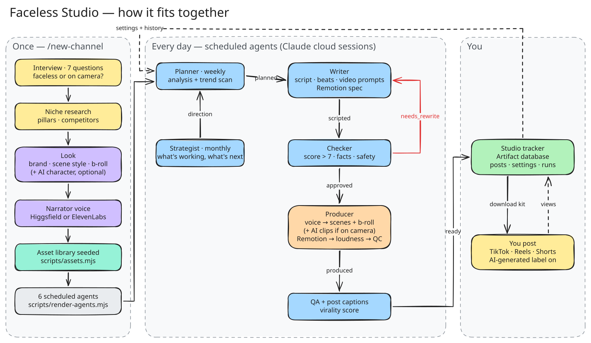
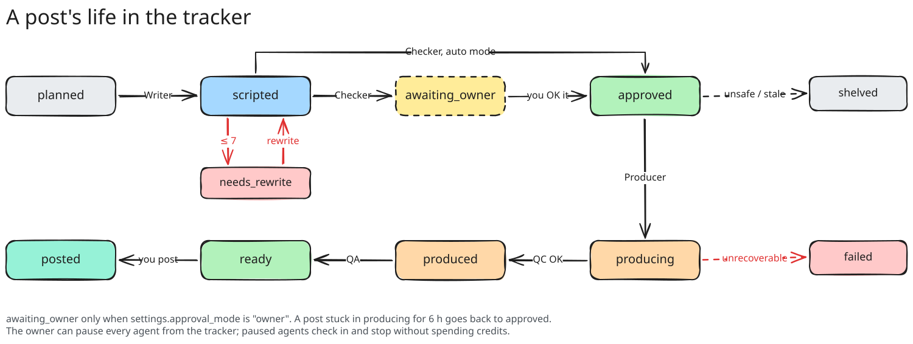
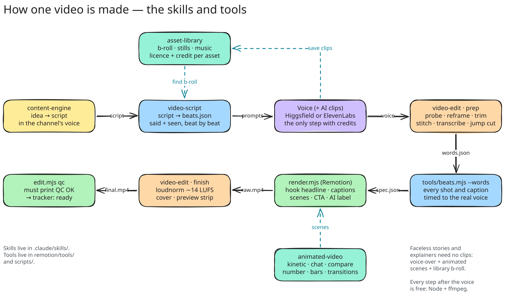

# Architecture

## Where things run
| step | runs in | tools |
|---|---|---|
| all agents | a fresh Claude cloud session per run | ArtifactData (tracker), WebSearch/WebFetch, Higgsfield MCP |
| trend scan, frame checks, Remotion render, captions timing | Higgsfield `sandbox_exec` (open internet, Node, ffmpeg, faster-whisper, Playwright Chromium) | `git clone` of this repo → `remotion/render.mjs` |
| character, voice, clips | Higgsfield generation tools | `generate_image`, `generate_video`, voices |
| test renders, studio previews | your machine | `./setup.sh`, `npm test` in `remotion/` |

## The tracker database
- `settings/channel` — the character and every rule (`channels/<slug>/settings.json`)
- `posts/p-NNN` — one document per video, moving through the statuses below
- `requests/rq-*` — topics viewers asked for in comments
- `runs/<agent>` — the last 20 log lines per agent

Statuses: `planned → scripted → needs_rewrite ↺ → awaiting_owner? → approved → producing → produced → ready → posted` (+ `failed`, `shelved`).

## How one video is made

| step | skill | tool |
|---|---|---|
| idea → script | `content-engine` | — |
| script → beats (said + seen) | `video-script` | `remotion/tools/beats.mjs` |
| b-roll, stills, music with licences | `asset-library` | `scripts/assets.mjs` |
| voice + character clips | `ugc-character-video` | Higgsfield (credits) |
| probe, reframe, trim, stitch, transcribe, jump cut | `video-edit` | `remotion/tools/edit.mjs`, `stitch.sh` |
| scenes for stories, explainers and inserts | `animated-video` | `remotion/src/shots/` |
| render, loudness, cover, delivery check | `video-edit` | `render.mjs`, `edit.mjs loudnorm` / `qc`, `cover.sh` |

## Why Remotion
AI video is great at a person; it's bad at text, numbers and exact timing. So Higgsfield makes the
character clip with no on-screen text, and Remotion draws the hook headline (fully visible from frame 0),
word-timed captions, stamps, charts and the CTA on top — deterministic, editable, and free.
Faceless channels (`format: "faceless"`, the default) are made entirely in Remotion: story and explainer scenes, library b-roll and a voice-over. Only on-camera channels (`format: "character"`) use Higgsfield character clips.

## Editing the diagrams
The diagrams are Excalidraw files in `docs/diagrams/`. Open a `.excalidraw` file at [excalidraw.com](https://excalidraw.com) (File → Open), edit it, then save it back and export the SVG next to it (Export image → SVG) so the docs update.
