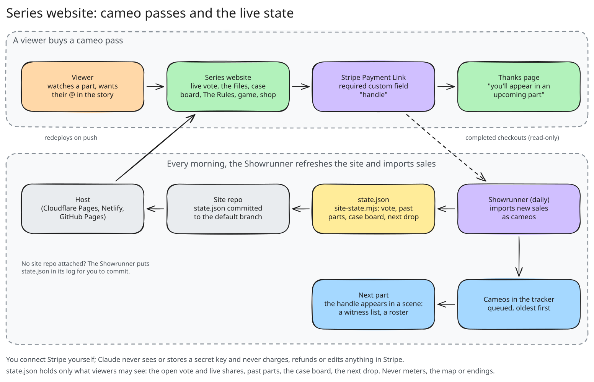

# Interactive story series

A story told in short parts where the audience decides what happens. Every part opens on what the
last vote caused and ends on an A/B/C choice. Viewers vote in the comments and in story polls, name
characters, and argue theories; you type the verdict into the studio page; the agents turn it into
the next part. Paid **cameo passes** put a buyer's @ inside a scene.

Proven by [PlotShift Studios](https://plotshiftstudios.com/) (a five-part second-person dilemma,
1.3M → 241k views, 46.9k followers) and [Saveo House](https://saveohouse.com/) (daily parts, a live
vote split on its site, paid case-board names). Set one up with `/new-channel` and pick
"interactive story" (`format: "story"`).

## The idea in one paragraph
"You" are in an impossible spot. Each part is 90-150 seconds of cinematic narration with a few
short lines spoken by the characters themselves. Behind the scenes the whole season is already
written as a branching **story map** with hidden meters (say Suspicion and Proof) and a set of
endings where you either **get away** or **get caught**. The audience never sees any of that: only
the story, the choice and last part's real vote share. So the votes feel like they matter, because
they do, and every path still reaches an ending in 4-12 parts.

## The hidden story map
The season lives in `channels/<slug>/story-map.json` (and in the tracker as `story/map`). The
Showrunner never improvises plot: it applies the map's rules to the winning vote and turns the node
it lands on into the next part. Smallest valid example: [examples/story-map.min.json](examples/story-map.min.json).

| field | what it is |
|---|---|
| `title`, `series`, `season`, `premise`, `pov` | the pitch; pov is usually "second person, present tense" |
| `start` | the node Part 1 plays |
| `stakes` | the hidden meters, each `{label, start, caught_at}` or `{label, start, cleared_at}` |
| `pressure.suspicion_per_part` | added every part, so every path closes in |
| `max_parts` | the season cap (10-12); the part that reaches it becomes an ending |
| `flags` | named facts a choice can set (`tampered`, `has_footage`), each with a one-line meaning |
| `cast[]`, `locations[]` | who and where (`id`, `name`, `role`, `look`) |
| `nodes[]` | one per part: `id`, `title`, `act`, `location`, `summary`, `scenes[]`, `cameo` (the in-world place buyer handles can appear), `choice {text ≤ 70, options[{key, label ≤ 40, to, stakes, flags}]}` with 2-3 options |
| `endings[]` | `id`, `title`, `type` (`got_away` or `caught`), `summary`, `final_line`, `season2_choice` |
| `rules` | where the meters send you: `cleared`, `cleared_min_proof`, `cleared_fallback`, `caught_default`, `caught_if_flag`, `caught_if_node_prefix`, `cleared_fail_caught_at_suspicion` |
| `ending_rank` | endings from best to worst (used by the Route Reveal) |
| `revisit_rule` | what to do when a path returns to a node it has played |

**How a vote resolves** (in this order): add the per-part pressure; apply the winning option's
stakes and flags; if suspicion reaches `caught_at` the next part is a caught ending; else if proof
reaches `cleared_at` it is the cleared ending; if the next part number hits `max_parts` it becomes an
ending; otherwise go to the option's `to`.

**Writing a good map:** 20-35 nodes, 2-3 options each, every option tempting and none obviously
right, 6-10 endings split roughly evenly between got away and caught, the shortest path 4+ parts.
Choices are decisions ("Run", "Call your sister"), never methods.

**Checking it:** `story-map-check.mjs` simulates every possible path with exactly the Showrunner's
rules: broken links, labels too long for the vote card, unreachable nodes, paths that never end,
which endings are reachable and how long paths run, and the optimal route. Fix until it prints
`MAP OK` with no warnings. `build-story-map.mjs` turns the map into a readable, playable page
(`channels/<slug>/story-map.html`) you can publish as an Artifact to read it like a book.

## The daily loop


| when (default) | who | what |
|---|---|---|
| ~7 pm | you | post the part from the studio page, AI label on |
| before 4 am | you, ~30 s | open the part's **The audience's verdict** box: A/B/C counts per source, suggested names, what people are saying; **Save the verdict** |
| 4:47 | Showrunner | imports cameo sales, closes the vote, applies the map, names and cameos, plans the next part, refreshes the website |
| 5:47 | Writer | scripts the part as beats (narrator + character lines) |
| 7:41 | Checker | scores it; with `approval_mode: "owner"` it waits for your OK |
| 9:43 | Producer | voices, then renders the whole part in Remotion |
| 15:47 | QA | captions with the choice spelled out, a story poll, the cover |
| Wednesdays | Series Developer | research, side content, pitches, new season maps |

Only one part is in the pipeline at a time, because each part depends on the last vote. If no
counts are entered once the vote window (`story.vote.window_hours`) has passed, the Showrunner logs
"Votes needed for Part n" and waits.

## The audience's voice
- **Sources:** comments on TikTok, Instagram and YouTube, Instagram story polls and YouTube
  community polls (`vote.sources`). They all count the same; the winner is the total.
- **Feedback:** what people are saying (write-in ideas, theories, standout comments) goes in
  `vote.feedback`. Comments that clearly mean one of the options in other words ("call your sister!")
  count for that option. A popular theory can earn a one-line nod in the next part
  (`feedback_nod`); never a username unless that person bought a cameo.
- **Naming:** cast members marked `nameable` get named by the audience. The part where they appear
  asks "Comment below: what's the victim's name?"; you tally the suggestions; the Showrunner picks
  the most suggested plausible name (not a real public figure, not a username, nothing offensive)
  and the next part credits it: "You named him Marcus."
- **Ties:** `story.vote.tie_rule`. Low turnout still counts.

## Episodes
- **90-150 s**, 230-380 spoken words, 30-50 shots, a new framing every 2-4 s.
- **Consequences first:** the first 8-15 s show what the last vote caused, as story ("71% of you said
  run. So you ran. Three streets later, every doorbell camera had your face."). Never as meters.
- **Voices:** an engaging cinematic narrator in second person ("you"), plus 1-4 short character
  lines per part in the character's own voice ("HEY! Come back here!"), shown as speech bubbles over
  the scene. The producer records each speaker's takes and joins them with `voice-track.mjs`.
- **Structure:** cold open on the consequence, 3-5 beats of escalation with a twist, the
  cliffhanger, then the choice; the vote card stays up 3.5 s after the last word.
- **On screen:** a title card at 0 s, cameo lists inside scenes, the A/B/C vote card at the end,
  captions throughout. No meter, ever. Long parts render in chunks with `render-long.mjs`.

## Looks
Set in `settings.story.look` at setup.
- **Stick** — stick-figure scenes drawn in code by Remotion (`scene` shots: sets, cast, poses,
  props, weather, light, camera moves). Zero credits per part; only the voices cost anything.
- **Illustrated** — AI-generated graphic-novel stills with one fixed hero reference, so the main
  character looks the same all season, brought to life with Remotion camera moves. All text, title
  cards and the A/B/C vote card are still Remotion, with quiet music and ambience under the
  narrator. Costs a few credits per still.

## Cameo passes
- Sold through **Stripe Payment Links** with a required custom field named `handle` (or Gumroad,
  entering handles by hand). Business cameos (a shopfront or sign) are a separate tier.
- Each morning the Showrunner reads completed checkouts through the Stripe connector, read-only,
  and queues each handle in the tracker's **Cameo passes**. It never charges, refunds or edits
  anything, and you never give Claude a secret key. No connector? Add handles in the tracker yourself.
- Up to `story.cameo.per_part` handles per part, oldest first, in that part's in-world slot (a
  witness list, a contacts screen, a crew roster). Status: queued → scheduled → featured.
- A cameo is never a suspect, killer, victim or anyone accused. Businesses appear, never endorsed.
- Promise "an upcoming part", not views or a date. Refund anyone you can't place within 30 days.



## The website (optional)
A static site per series: the live vote, the Files (past parts and what won), the case board of
cameo handles, The Rules, a browser game for finished seasons and a shop. The Showrunner refreshes
its `state.json` daily (only what viewers may see). Setup, hosting and Stripe: [WEBSITE.md](WEBSITE.md).

## The Series Developer (weekly)
Researches what interactive series are growing (Saveo House, PlotShift and others), plans 2 side
posts at a time between parts (a "story so far" recap, a character profile, a case-board post, a
poll, a "you named him" thank-you), and once a month writes **3 pitches** to the tracker's **Next
series ideas**. Approve one and it writes and checks the full map (`story/maps/<pitch id>`, status
"map ready"). You choose when it becomes the next season; it never replaces the live map itself.

## Season end
1. **The ending part** plays the ending's final line and asks a season-two question instead of a
   plot choice.
2. **The Route Reveal**: once that vote closes, the Showrunner plans a bonus episode comparing the
   route the audience voted for with the **perfect run** (the shortest route to the best ending in
   `ending_rank`): the **turning point** (the first vote that took a better ending off the table,
   with its real vote share), the **close calls**, and how many votes matched the best move. This is
   the one episode that may show the map's routes; still no meters.
3. **Next season**: when the Route Reveal is posted and a next map is chosen, the Showrunner archives
   the season and starts Part 1 of the new map. Queued cameo passes carry over.
4. **The gamebook**: a pick-your-own-path book built from the season's map ("turn to page 12"),
   sold after the season ends and mentioned in the recap episode. See [GAMEBOOK.md](GAMEBOOK.md).
   The website's browser game plays the same finished map.

## Content rules (built into the agents)
Fiction only, not resembling a real case or real people; violence implied, never shown; choices are
decisions, never methods; cameo handles never placed as anyone accused; AI-generated label on every post.

## Commands
```bash
node scripts/story-map-check.mjs channels/<slug>/story-map.json [--paths]   # simulate every path; MAP OK
node scripts/build-story-map.mjs <slug>                                     # channels/<slug>/story-map.html
node scripts/story-route-compare.mjs channels/<slug>/story-map.json \
  --route "S1:A,R1:A,D1:A" --pct "S1:A=58,R1:A=64" [--spec reveal.json]    # Route Reveal numbers + spec
node scripts/story-route-compare.mjs map.json --canon canon.json --json     # the same from settings.story.canon
node remotion/tools/voice-track.mjs takes.json voice.mp3                    # join narrator + character takes
node remotion/tools/beats.mjs beats.json spec.json --words words.json       # beats → timed spec (bubbles, cameos, vote card)
node remotion/tools/render-long.mjs spec.json part.mp4 [--chunk 25]         # render a 90-150 s part in chunks
node scripts/build-site.mjs <slug>                                          # the series website (WEBSITE.md)
node scripts/site-state.mjs <tracker-export-dir> <site-dir>                 # refresh the site's state.json
```

Tracker documents: `settings/channel` (`format: "story"` and a `story` block: cast, look, stakes,
canon, position, vote, cameo), `story/map`, `story/maps/<id>`, `posts/p-NNN` (one per part, with
`choice`, `cameos`, `naming`, `vote.sources`/`counts`/`feedback`/`names`), `cameos/c-*`,
`pitches/pi-*`, `seasons/s<n>`. Shot and overlay fields for parts: [remotion/SPEC.md](../remotion/SPEC.md).
